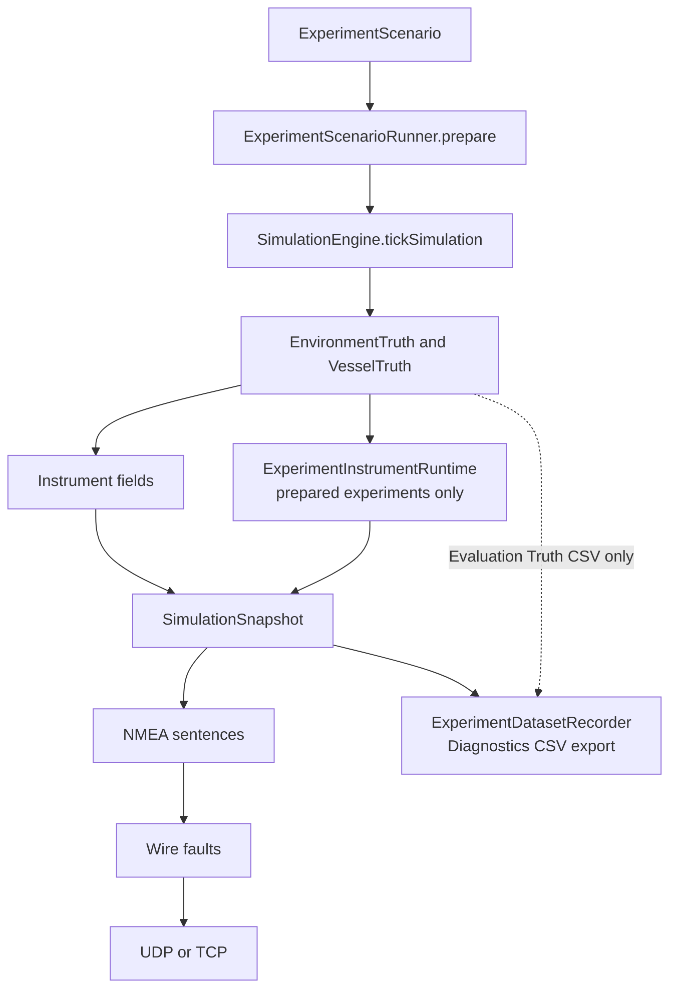

# Experiment data flow

The diagram shows the path a controlled run takes today. The operator fields on the snapshot stay the instrument copies. A prepared experiment adds `experimentPublication` beside them and optionally buffers sampled rows into `ExperimentDatasetRecorder`. A normal operator session leaves `experimentPublication` nil.

`prepare` builds an `ExperimentRuntime` and returns it. The operator session is not replaced. Experiment Diagnostics keeps its own runtime, created from a clean baseline in an isolated defaults suite, while persisting only the Diagnostics form inputs in `UserDefaults.standard` under `"experiment_diagnostics.inputs"`. The guide is `.agent/guides/m3.4.3a-experiment-diagnostics.md`.

## What each stage actually does

**Scenario.** `ExperimentScenario` is a `Codable` value of format version 1. It holds a seed, a reference `BoatProfile`, a hidden `BoatProfile`, `PerformanceParameters` (`hiddenPerformance`), an `ExperimentWindProgram` (steady or deterministic sinusoidal direction swing + speed amplitude/period), an `ExperimentCurrentProgram` (set and drift), `courseSweepDegreesPerSecond`, duration, sample interval, and an `ExperimentOutputContract`. The contract's default measurement list is `timestamp`, `trueWindDirection`, `trueWindSpeed`, `trueHeading`, and `speedThroughWater`, with `permitsGroundTruthExport = false`.

**Preparation.** `ExperimentScenarioRunner.prepare` copies the baseline state and config. It seeds `ExperimentRandomGenerator`, creates a fresh `ExperimentInstrumentRuntime` from the same scenario seed, sets `hiddenPolarOverride`, `performance = hiddenPerformance`, `courseSweepDegreesPerSecond`, sets the reference profile on the config and on `VesselObservation`, forces manual weather and estimated speed, and writes the initial wind and `ExperimentCurrentProgram` into `EnvironmentTruth` with wind offset 0. It does not write `SimulatorSettings`, `SimulationInputMirror`, or operator `UserDefaults`. A later `prepare` replaces the instrument model so the new run starts cleanly from sample 0.

**Engine.** `tickSimulation` advances one timestamp. On `evolveSensors` ticks it evaluates `windProgram.sample(elapsedSeconds:)` when present (otherwise drawing from `experimentRandomGenerator`), sweeps `trueHeading` and `magneticHeading` continuously when `abs(courseSweepDegreesPerSecond) > 1e-6`, computes target speed through water from `hiddenPolar` and `PerformanceParameters` (with instant or first-order lag), adds `simulatedCurrent` to the water vector in `simulatedMovement` to form `SOG` and `COG`, integrates position (and sets tick-0 `SOG`/`COG` even when `deltaTime == 0`), and builds a snapshot. After truth is stored, a prepared experiment records one measurement for that timestamp.

**Physical truth.** After the tick, `EnvironmentTruth` and `VesselTruth` are the numbers that moved the boat.

**Instrument fields.** The tick copies truth onto the instrument values and nils the values whose sensors are off.

**Measurement model.** When `experimentInstruments` is present, the tick calls `measure` once for each new timestamp and stores the sample on that runtime. A repeated timestamp does not draw again; building sentences or refreshing UI does not draw. Inputs are physical true wind, physical true heading, speed through water, magnetic variation, and compass deviation. Availability comes from the anemometer, speed log, gyro, and compass switches. Errors do not feed back into `EnvironmentTruth` or `VesselTruth`.

**Snapshot.** `SimulationSnapshot` keeps the operator instrument fields and sets `experimentPublication`. It carries no hidden polar and no `PerformanceParameters`.

**CSV Export (`ExperimentDatasetExporter`).** `ExperimentDatasetRecorder` samples `ExperimentDiagnosticsSession` at `sampleIntervalSeconds` (default 1 s). `estimatorCSV(contract:)` emits only the fields allowed by `ExperimentOutputContract` (measurement path only, excluding truth and hidden factors by default). `evaluationTruthCSV()` writes a separate validation file with physical truth (`truth*`) for offline RMSE scoring.

**Sentences, faults, and transport.** Without a publication, builders keep the operator formulas. With a publication, `MWV`, `MWD`, `VPW`, `HDG`, `HDT`, `VHW`, and the water half of `VBW` read `experimentPublication`. `SentenceScheduler` applies optional unseeded wire faults before UDP/TCP dispatch.

## Paths that skip a stage

| Path | What it skips | Consequence |
|---|---|---|
| Operator session with a nil scenario | `prepare` | No seed, no hidden override, `simulatedCurrent` uses `.none` (zero). System randomness. Selected boat is both reference and hidden. |
| Live weather | The manual uniform wind draw | Forecast plus an unseeded Ornstein–Uhlenbeck wander is committed into wind truth. |
| GPS coordinate generation | Dead reckoning for one adoption | An edited fix replaces vessel latitude and longitude. |
| Disabled speed log | Published boat speed only | Truth speed remains; apparent wind uses nil snapshot speed and is suppressed. |
| No `experimentInstruments` | The measurement sample | Operator NMEA keeps the previous formulas. |
| Idle or single send | The 20 Hz timer, not the engine | `sendAllSelectedNMEA` and a timer-off start still call one simulation cycle. |

## Who may see the hidden polar

| Component | Hidden polar & factors | Reference profile | Physical truth | Measurements |
|---|---|---|---|---|
| `SimulationEngine` speed | Reads `hiddenPolarOverride` + `performance` | Does not use it for the table | Writes it | Does not apply sensor error |
| `ExperimentScenario` | Stores them | Stores it | No | Declares export contract |
| `VesselObservation` | No | Yes | No | Sailing-state label only |
| `SimulationSnapshot` and NMEA | No | No | No | Instrument fields only |
| `ExperimentDatasetRecorder.estimatorCSV` | Never | Implicitly via scenario contract | Never (unless contract explicitly overrides) | Permitted fields only |
| `ExperimentSensorModel` | No | No | Reads copies of four numbers | Returns a separate value |
| Estimator (`PolarRecoveryProofOfConceptTests` / future `PolarResearchCore`) | Must not receive it as data | May receive it (or `ParametricPolarGenerator` prior) | Only in separate evaluation scoring | Permitted CSV fields only |
