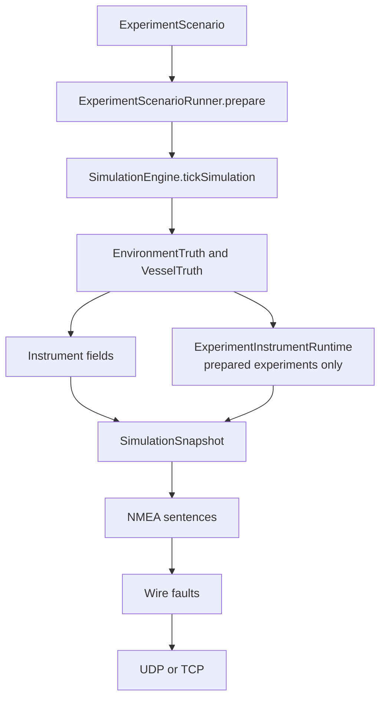

# Experiment data flow

The diagram is the path a controlled run can take today. The operator fields on the snapshot stay the instrument copies. A prepared experiment adds `experimentPublication` beside them. A normal session leaves that field nil.

`prepare` builds an `ExperimentRuntime` and returns it. The operator session is not replaced. Experiment Diagnostics keeps its own runtime, created from a clean baseline in an isolated defaults suite. The guide is `.agent/guides/m3.4.3a-experiment-diagnostics.md`.

## What each stage actually does

**Scenario.** `ExperimentScenario` is a Codable value of format version 1. It holds a seed, a reference `BoatProfile`, a hidden `BoatProfile`, a steady true-wind program, an `ExperimentCurrentProgram`, a duration, a sample interval, and an `ExperimentOutputContract`. The contract's default measurement list is timestamp, true wind direction, true wind speed, true heading, and speed through water. Ground-truth export is false. Nothing in the app writes this value to disk as an experiment file. Codable is tested in memory.

**Preparation.** `ExperimentScenarioRunner.prepare` copies the baseline state and config. It seeds `ExperimentRandomGenerator`, creates a fresh `ExperimentInstrumentRuntime` from the same scenario seed, sets `hiddenPolarOverride`, sets the reference profile on the config and on `VesselObservation`, forces manual weather and estimated speed, and writes the steady wind into the setpoints and into `EnvironmentTruth` with wind offset 0. It does not write `SimulatorSettings`, `SimulationInputMirror`, or `UserDefaults`. The current program remains on the scenario. A later `prepare` replaces the instrument model, so the new run does not continue the previous random stream.

**Engine.** `tickSimulation` advances one timestamp. It redraws the environment when a second has elapsed, steers, computes speed, integrates position, and builds a snapshot. Estimated speed reads environment wind and the hidden table. It does not read the measurement. After truth is stored, a prepared experiment records one measurement for that timestamp.

**Physical truth.** After the tick, `EnvironmentTruth` and `VesselTruth` are the numbers that moved the boat. The 1 Hz uniform redraw replaces those numbers. It is not a layer underneath them.

**Instrument fields.** The tick copies truth onto the instrument values and then nils the values whose sensors are off. A disabled anemometer therefore leaves wind truth intact and leaves `twd.value` and `tws.value` nil.

**Measurement model.** When `experimentInstruments` is present, the tick calls `measure` once for a new timestamp and stores the sample on that runtime. A repeated timestamp does not draw again. Building a sentence does not draw. The inputs are physical true wind, physical true heading, speed through water, and the tick's variation and deviation. Availability comes from the anemometer, speed log, gyro, and compass switches. The result is not written back into `EnvironmentTruth` or `VesselTruth`. A zero-error sample matches physical true wind except when the vessel is moving through still air. The compass does not feed the gyro channel. True wind direction for publication prefers the gyro reading, then the compass card plus deviation and variation once each, and otherwise stays nil. The inventory is `.agent/architecture/marine-instruments.md`.

**Snapshot.** `SimulationSnapshot` keeps the operator instrument fields. A prepared experiment also sets `experimentPublication`. The snapshot has no hidden polar and no performance factors.

**Sentences.** Without a publication, builders keep the previous formulas. With a publication, MWV, MWD, VPW, HDG, HDT, VHW, and the water half of VBW read that publication. A missing or negative speed is omitted. Sentence switches still decide whether a sentence is due.

**Faults and transport.** `SentenceScheduler` applies drop, delay, checksum corruption, or invalid status after the sentence exists. Those draws are unseeded. Endpoints then send UDP or TCP. A fault does not change truth.

## Paths that skip a stage

| Path | What it skips | Consequence |
|---|---|---|
| Operator session with a nil scenario | `prepare` | No seed, no hidden override. System randomness. The selected boat is both reference and hidden. |
| 1 Hz redraw | A fixed truth under the instruments | The sample becomes `EnvironmentTruth` or the steered heading. |
| Live weather | The manual uniform wind draw | Forecast plus an unseeded wander is committed into wind truth. |
| GPS coordinate generation | Dead reckoning for one adoption | An edited fix replaces vessel latitude and longitude. |
| `simulatedCurrent` | The scenario current | The declared set and drift do not move the boat. The sum is hard-coded to zero. |
| Disabled speed log | Published boat speed only | Truth speed remains. Apparent wind uses the nil snapshot speed and is suppressed. |
| No `experimentInstruments` | The measurement sample | Operator NMEA keeps the previous formulas. |
| Idle or single send | The 20 Hz timer, not the engine | `sendAllSelectedNMEA` and a timer-off start still call one simulation cycle. |

## Who may see the hidden polar

| Component | Hidden polar | Reference profile | Physical truth | Measurements |
|---|---|---|---|---|
| `SimulationEngine` speed | Reads it | Does not use it for the table | Writes it | Does not apply sensor error |
| `ExperimentScenario` | Stores it | Stores it | No | Declares a future export list |
| `VesselObservation` | No | Yes | No | Sailing-state label only |
| `SimulationSnapshot` and NMEA | No | No | No | Instrument fields only |
| Operator settings and UI | No | The selected vessel | Indirectly, through setpoints | Sensor switches |
| `ExperimentSensorModel` | No | No | Reads copies of four numbers | Returns a separate value |
| A future estimator | Must not receive it as data | May receive it | Only if the output contract is changed | The permitted fields |

`hiddenPolarOverride` is a field on the runtime state. A careless debug dump of `SimulationState` would reveal it. The sentence path does not.
