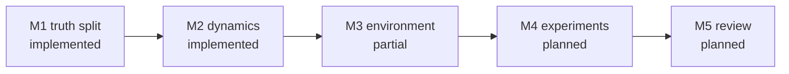

# Implementation status

`.agent/ROADMAP.md` still describes M3 as a seed plus a scenario contract, and it tells the reader not to start runtime application. The code has moved past that sentence. This page classifies behavior that runs, not types that merely exist. The October 2026 audit in `.agent/investigations/research-readiness-2026-10.md` is historical. It says there is no truth split, no seed, and no hidden polar. Those three statements are false for the current tree.

## Rev 0.3 roadmap

| Piece | Class | Evidence |
|---|---|---|
| Environment and vessel truth | Implemented | `EnvironmentTruth`, `VesselTruth`, written only inside the tick. |
| Sensor readings distinct from truth | Partial | Switches hide instruments. The 1 Hz redraw is still written into truth. The error model is not on that path. |
| NMEA from one snapshot | Implemented | `SimulationSnapshot` and the sentence builders. |
| 20 Hz physics, 1 Hz redraw, 10 Hz UI | Implemented | Constants on `NMEASimulator` and `SimulationEngine`. |
| Polar table and interpolation | Implemented | `PolarTable` for Extasy only. |
| Hidden polar separate from reference | Implemented | `hiddenPolarOverride` drives speed. Reference does not scale it. |
| Instant speed, optional first-order lag, maneuver retention | Implemented | Defaults preserve instant speed and retention 1. |
| Sail configuration | Implemented as data | Three states: inventory, saved selection, hoisted set. None of them change speed. |
| Seeded manual evolution | Implemented | `ExperimentRandomGenerator` when a scenario or a test enables it. Nil in a normal session. |
| Scenario record | Partial | Version 1 value, sanitized, Codable in tests. Not a saved library. |
| In-memory scenario application | Implemented | `ExperimentScenarioRunner.prepare`, plus the Experiment Diagnostics page. The page is not a saved scenario library. |
| Steady wind | Implemented | Offsets forced to 0 at prepare. The 1 Hz redraw then stays on that center. |
| Current | Planned as motion | The struct exists. `simulatedCurrent` returns zero. |
| Sensor bias and uniform noise | Partial | A prepared experiment samples apparent wind, the log, a true-heading instrument, and a magnetic compass after each new timestamp and publishes them. A normal session does not. Delay and dropout are absent. |
| Sensor delay and dropout | Planned | Not present. |
| Wire faults | Implemented | Post-sentence, default off, unseeded. |
| JSON scenario files, CSV export, replay | Planned | M4. Codable is not a file workflow. |
| Scientific review against a real boat | Planned | M5. This directory is a map, not that review. |

## Rev 0.2 task list

The audit's tasks 1 through 4 are implemented: state split, polar abstraction, first-order speed, maneuver heading and retention.

Task 5, wind scenarios and current, is **partial**. Steady wind is applied. There is no time-varying wind program and no current vector.

Task 6, sensor error, is **partial**. Availability is independent of motion. Bias and noise exist off to the side. Delay, drift, and dropout do not.

Task 7, JSON scenarios, is **partial**. The record encodes and decodes. It is not stored as an experiment document.

Tasks 8 and 9, CSV export and a baseline-versus-hidden experiment the estimator can see, are **planned**. The simulator can already sail two profiles. It cannot yet hand the pair to an estimator.

Task 10, validation tests, is **partial**. The macOS non-UI suite covers sentences, transport, polars, maneuvers, scenario preparation, truth boundaries, and the unused measurement model. It does not validate the boat against trials. The last recorded full result is 319 passed, 0 failed, 0 skipped, on 2026-11-11, from the diagnostics session.

## Requires verification

| Item | Why it is not closed |
|---|---|
| Farr table versus the PDF | Tests lock a few cells. A cell-by-cell checksum against the PDF is not this map's claim. |
| Live-weather numerical repeatability | The wander uses `Double.random`. |
| Wire-fault repeatability | The injector uses system randomness. |
| Extasy Complete Navigation | Not in this workspace. |
| ORC certificates as a speed model | Stored as documents. Not interpolated by `PolarTable`. |
| Magnetic variation | A formula is implemented. It is not checked against a magnetic model. |

## Explicitly not complete

A type named `ExperimentCurrentProgram` does not make current real. A type named `ExperimentSensorModel` does not make NMEA noisy. A type named `ExperimentOutputContract` does not export a dataset. `BoatProfile.nimana` does not have a polar.
