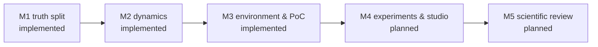

# Implementation status

This page classifies behavior that actually runs in the current codebase (`main`), replacing earlier pre-M3 notes. The October 2026 audit in `.agent/investigations/research-readiness-2026-10.md` is historical and predates M1–M3.

## Rev 0.3–0.4 status matrix

| Piece | Class | Evidence |
|---|---|---|
| Environment and vessel truth | Implemented | `EnvironmentTruth` and `VesselTruth`, written only inside `SimulationEngine.tickSimulation`. |
| Sensor readings distinct from truth | Implemented (experiments) | `ExperimentInstrumentRuntime` samples `ExperimentSensorModel` per new timestamp for prepared runs; normal operator sessions leave `experimentPublication` nil. |
| NMEA 0183 from one snapshot | Implemented | `SimulationSnapshot` and `NMEASimulator+SentenceBuilder` (including `MDA` and `XDR` atmospheric sentences). |
| 20 Hz physics, 1 Hz redraw, 10 Hz UI | Implemented | Constants on `NMEASimulator` and `SimulationEngine`. |
| Polar table and interpolation | Implemented | `PolarTable` for Beneteau First 40.7 (Farr #354) with pinching roll-off below `33°`. |
| Hidden polar & multipliers separate from reference | Implemented | `hiddenPolarOverride` + `PerformanceParameters` (`hullFactor`, `sailFactor`, `trimEfficiency`, `seaStateFactor`) drive truth speed; never emitted on NMEA or estimator CSV. |
| Instant speed, optional first-order lag, maneuver retention | Implemented | `SimulationEngine.respondedSpeed` and `maneuverRetention`; defaults preserve instant speed and retention `1`. |
| Sail configuration | Implemented as data | Inventory, saved selection, and hoisted set in `VesselProfile` / `SailInventory`; does not yet scale `SimulationEngine` speed directly. |
| Seeded manual evolution & wind/course sweep | Implemented | `ExperimentRandomGenerator`, deterministic sinusoidal `ExperimentWindProgram` (swing, speed amplitude, period), and `courseSweepDegreesPerSecond`. |
| Current set/drift kinematics | Implemented | `ExperimentCurrentProgram` wired into `EnvironmentTruth` and `SimulationEngine.simulatedCurrent` / `simulatedMovement`, separating `SOG`/`COG` from `STW`/`HDT` (including tick-0 initialization). |
| In-memory scenario & isolated Diagnostics UI | Implemented | `ExperimentScenarioRunner.prepare` and `ExperimentDiagnosticsView` / `ExperimentDiagnosticsSession` (with `UserDefaults` persistence for Diagnostics inputs). |
| CSV dataset export (`ExperimentOutputContract`) | Implemented (PoC) | `ExperimentDatasetExporter` (`Export CSV…` exports permitted measurements only; `Export Truth…` writes ground truth separately via `NSSavePanel` with `readwrite` sandbox entitlement). |
| Offline polar recovery & cold-start VPP prior | Implemented (PoC tests) | `PolarRecoveryProofOfConceptTests` (reduces degraded polar RMSE from `> 1.5 kn` to `< 0.15 kn` from noisy CSV); `ParametricPolarGenerator` + `ParametricPolarComparisonTests` (geometry-only prior + cold-start adaptation). |
| Sensor delay, drift, and dropout | Planned | M4. Only fixed bias, uniform noise, and boolean instrument availability exist today. |
| Wire faults | Implemented | `SentenceScheduler` drop, delay, checksum corruption, and invalid status; unseeded, default off. |
| Angle-dependent polar degradation | Planned | M4. Hidden multipliers currently scale all wind angles uniformly. |
| JSON scenario library, replay suite, Research Studio UI | Planned | M4. `ExperimentScenario` is `Codable`, and PoC CSV export exists, but there is no saved library UI, replay runner, or in-app polar visualization/estimator UI (`PolarResearchStudio`). |
| `BoatProfile.nimana` ORC polar | Planned | `ORC_2026_009-26.pdf` is stored in `Resources/ReferenceDocuments/Nimana/`; `BoatProfile.nimana` polar table remains nil. |
| Scientific review against real boat logs | Planned | M5. |

## Verification snapshot

- **Focused M3 + PoC suites (verified 2026-11-16):** `ExperimentScenarioRunnerTests`, `ExperimentDiagnosticsSessionTests`, `PolarRecoveryProofOfConceptTests`, and `ParametricPolarComparisonTests` all pass against the current codebase.
- **Full non-UI suite:** `319 passed, 0 failed, 0 skipped` was recorded on 2026-11-11 prior to M3-A/M3-B/PoC additions; re-run full suite before M4 milestones.

## Requires verification / Known scientific caveats

| Item | Why it is not closed |
|---|---|
| Farr table vs. PDF | Spot-checked in unit tests (`45°/12 kn`, `90°/12 kn`), not a full cell-by-cell checksum against the PDF. |
| Live-weather numerical repeatability | Open-Meteo / MET Norway wind wander uses unseeded `Double.random`. |
| Wire-fault repeatability | `SentenceScheduler` fault injection uses system randomness. |
| Extasy Complete Navigation | Separate repository/product; parser and polar internals are unverified here. |
| ORC certificates as a speed model | Stored as PDFs; not yet parsed into `PolarTable`. |
| Magnetic variation | Geographic sine cartoon in `SimulationEngine.simulatedMagneticVariation`; not checked against WMM. |
| Parametric VPP prior (`ParametricPolarGenerator`) | Purely geometry-based prior (`Total RMSE ≈ 1.082 kn` vs. Farr #354 before adaptation, `0.547 kn` after 12-minute cold-start adaptation); intended as a cold-start baseline, not an ORC replacement. |
