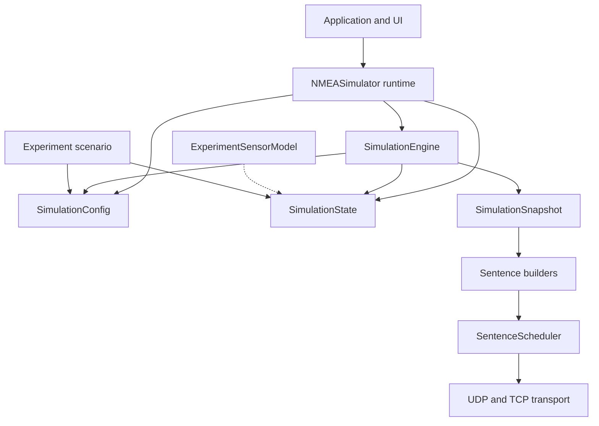

# MarineSimulator components

This map groups the running application by responsibility. It is not a file inventory. Arrows are the main compile-time and call dependencies, not every helper call.

The dotted arrow is deliberate. `ExperimentSensorModel` can read numbers taken from `SimulationState`, and the engine never calls it. A reader should not follow that arrow as a live data path.

## Application and UI

`NMEASimulator` (`NMEA/NMEASimulator.swift`) is the observable application model. SwiftUI views in `Views/` edit it: connection and endpoints, the simulation dashboard, the boat-profile library, and the map. The map does not chase the vessel. The console is an AppKit text view because a large SwiftUI list starved slider input.

UI publication is 10 Hz (`displayPublishInterval` = 0.1 s), coalesced on the main queue. The physics timer is not that clock.

Persistence is `SimulatorSettings` through `PersistenceManager` and `UserDefaults`. The experiment seed, the hidden polar override, and `ExperimentSensorModel` are not in those settings.

## Runtime configuration

`SimulationConfig` (`Model/SimulationConfig.swift`) is the read-only tick input: sensor and sentence switches, weather mode, boat-speed mode, reference `BoatProfile`, maneuver settings, talker identity, depth offset, wire-fault settings, and endpoints.

`configuredForExperiment` replaces weather mode, speed mode, and the reference profile on a copy. It does not write the operator's saved settings.

## Physical vessel state and environmental truth

Both structs live on `SimulationState` (`Model/SimulationState.swift`).

`EnvironmentTruth` holds true wind direction and speed, sea and air temperature, humidity, pressure, and depth. `VesselTruth` holds latitude, longitude, magnetic and true heading, speed through water, speed over ground, and course over ground.

`VesselObservation` is not vessel truth. It holds the reference profile, maneuver phase and kind, hoisted sails, and a sailing-state label. Sail identifiers are not a force model. `SailPerformanceConsistency` only reports a tag mismatch.

## Polar speed, maneuvers, and steering

`SimulationEngine.tickSimulation` (`NMEA/SimulationEngine.swift`) is the only physics step. `PolarModel` (`Model/BoatProfile.swift`) looks up a table. Only `BoatProfile.beneteauFirst407` has a table (`hasSpeedPolar`). Nimana returns nil, and estimated mode then holds the previous speed through water when a hidden Nimana override is set.

Maneuver heading is `ActiveManeuver` plus `maneuverHeading` and `applyDrivenManeuverHeading`. The dashboard starts a maneuver through `NMEA/NMEASimulator+Tack.swift`. Command eligibility still requires an anemometer and a heading instrument. Once `activeManeuver.drivesHeading` is set, the tick follows the plan without those switches.

## Sensor availability and instrument measurements

`SensorToggleStates` (`Model/SensorToggleStates.swift`) is persisted with the operator session. The tick samples physical wind, heading, depth, and manual speed regardless of the matching switch, then clears the instrument field when the switch is off. GNSS and DSC flags are stored and do not affect the tick.

`ExperimentSensorModel` is the measurement error model. `prepare` stores one `ExperimentInstrumentRuntime` on the experiment state. The tick advances it once per new timestamp and puts `experimentPublication` on the snapshot. A normal tick leaves that field nil. Experiment Diagnostics is a separate SwiftUI page. Its session calls `prepare` on a clean baseline and steps `tickSimulation`. It does not replace the operator runtime. The inventory is `.agent/architecture/marine-instruments.md`. The page guide is `.agent/guides/m3.4.3a-experiment-diagnostics.md`.

## Snapshots, sentences, scheduling, transport

`SimulationSnapshot` copies the instrument fields after the tick, plus GPS, turn rate, log distances, and an optional navigation target. Sentence builders in `NMEA/NMEASimulator+SentenceBuilder.swift` and the wind helpers in `NMEA/NMEASimulator+WindCalculations.swift` read that snapshot.

`SentenceScheduler` chooses which due sentences leave, then `applyFaultInjection` may drop, delay, corrupt a checksum, or mark a field invalid. Faults are off by default. Transport is endpoint UDP or TCP (`TransportManager`, `OutputEndpoint`).

## Experiments and randomness

`ExperimentScenario` is a versioned in-memory record (`Model/ExperimentScenario.swift`). `ExperimentScenarioRunner.prepare` copies a baseline runtime, seeds `ExperimentRandomGenerator`, sets the hidden override and the reference profile, and writes steady wind with zero wind offset. `ExperimentCurrentProgram` stays on the record. `simulatedCurrent` returns zero.

`ExperimentRandomGenerator` is optional on `SimulationState`. Nil means `Double.random` for the manual redraw. A second generator, `measurementRandomGenerator`, draws air, humidity, and pressure so those switches do not shift the physical stream. `ExperimentSensorModel` builds five further generators from its own seed and does not touch either of those. Channels 1–4 keep their earlier seeds. Channel 5 is the magnetic compass.

## Automated validation

Tests live in `MarineSimulatorTests/` and are picked up as a synchronized group. They do not need an Xcode file reference. The families that lock this architecture are `TruthSeparationTests`, `PolarDynamicsTests`, `ExperimentScenarioRunnerTests`, `MeasurementBoundaryTests`, `ExperimentSensorModelTests`, `ManeuverCommandTests`, and `SimulationPhysicsTests`. Sentence, transport, vessel-library, and live-weather tests lock neighboring behavior.

The last recorded macOS non-UI result is 319 passed, 0 failed, 0 skipped (`Test-MarineSimulator-2026.11.11_18-50-00-+0000.xcresult`).
