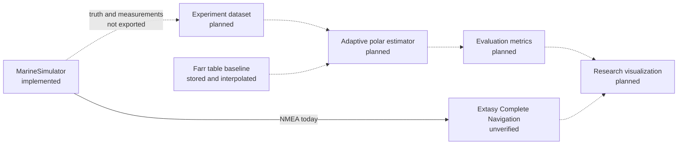

# Research architecture

These components are the target shape of the study. Presence in this diagram is not presence in the repository. Extasy Complete Navigation was not in the workspace. Its internal design is **unverified**.

Solid lines exist as NMEA output from this simulator. Dotted lines are the study's intended data, not an interface in this code.

## Roles

**Experiment dataset.** A future table of one run: scenario identity, seed, timestamps, the measurements the output contract allows, and, in a separate ground-truth section that the estimator cannot see, the hidden polar identity and the physical state. `ExperimentOutputContract` already names the default measurement fields and defaults `permitsGroundTruthExport` to false. There is no file format, no writer, and no reader. Status: **planned**, with the field list **partially implemented** as a struct.

**PolarResearchCore.** A future library that estimates a speed polar from the measurement section alone. It should accept the reference polar as a starting table and must not be given the hidden polar as an input feature. It does not exist in this repository. Status: **planned**.

**Extasy polar calibration baseline.** The implemented baseline is the Farr Design #354 table embedded in `PolarTable`, traced to `Resources/ReferenceDocuments/Extasy/Farr_Design_354_Performance_Prediction.pdf`. It is a manufacturer VPP for a First 40.7 racing version, not an ORC certificate and not a calibration performed on the water by this project. The ORC Club certificate for the vessel Extasy is a separate PDF in the same folder. Nimana has an ORC certificate and no manufacturer speed table. Status of the table lookup: **implemented**. Status of a calibration that adjusts that table to the real boat: **planned** and **unverified**.

**Adaptive polar estimator.** Not implemented. A scientifically usable estimator would consume true wind speed, true wind angle, and speed through water after the measurement model is actually connected, and would publish a table that can be compared with the hidden table offline. No algorithm, gain, or convergence test exists here. Status: **planned**.

**Evaluation metrics.** Not implemented. A later comparison can use the hidden table because the simulator knows it. That comparison is not available to Extasy. No RMSE, no polar-plot residual, and no experiment log are computed today. Status: **planned**.

**Research visualization.** Not implemented. The simulator's map and dashboard show the operator session. They are not a polar-research interface. Status: **planned**.

**Extasy Complete Navigation.** A separate navigation application. This simulator's transport can send it NMEA 0183. `SIMULATOR_ACCURACY.md` and `Docs/FutureTasks.md` mention that product. They do not describe its parser, filters, or polar code. Status of integration: **partial** at the sentence boundary only. Status of Extasy's internals: **unverified**.

## What the study can already rely on

The simulator can hold a hidden Extasy table and a reference Nimana profile, or the reverse, and the track follows the hidden table. Sensor switches do not change that track. A caller can add bias and noise to three channels without writing those errors back, but only if that caller keeps the `ExperimentMeasurement` itself. The chart plotter, today, receives the instrument snapshot, which is the physical sample when the sensor is on and is empty when the sensor is off.

## What the study must not claim yet

It cannot yet say how much of a hidden polar is recoverable from standard NMEA, because the measurement error is not on the sentences, the sentences are not logged beside the truth, and no estimator has been run. It cannot say that the Farr table is the real Extasy. It cannot say what Extasy Complete Navigation does with a sentence after it arrives.
