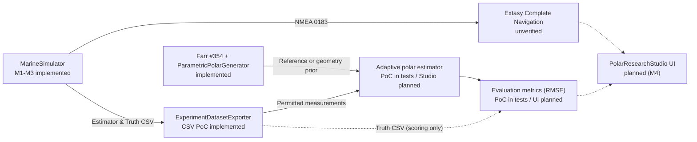

# Research architecture

These components are the target shape of the study. Extasy Complete Navigation is in a separate repository/workspace and its internal parser/polar code remains **unverified** here.

## Roles

**Experiment dataset (`Model/ExperimentDatasetExporter.swift`).** Samples `ExperimentDiagnosticsSession` at `sampleIntervalSeconds` and serializes two strictly separated CSV files via `NSSavePanel` (`readwrite` sandbox entitlement):
- `experiment-measurements.csv`: respects `ExperimentOutputContract.estimatorInput` (`timestamp,trueWindDirection,trueWindSpeed,trueHeading,speedThroughWater` by default, `permitsGroundTruthExport = false`), excluding truth and hidden multipliers.
- `experiment-truth.csv`: separate ground-truth table (`truthTrueWindDirection`, `truthTrueWindSpeed`, `truthTrueHeading`, `truthSpeedThroughWater`, `truthSpeedOverGround`, `truthCourseOverGround`, `truthLatitude`, `truthLongitude`) for offline validation only.
- Persistent JSON scenario library and batch replay remain **planned (M4)**.

**Extasy baseline & parametric cold-start prior.**
- **Farr Design #354 baseline:** embedded in `PolarTable` (`Model/BoatProfile.swift`), traced to `Resources/ReferenceDocuments/Extasy/Farr_Design_354_Performance_Prediction.pdf`.
- **Geometry-only VPP prior (`Model/ParametricPolarGenerator.swift`):** derives a cold-start polar solely from `HullDimensions`, `RigDimensions`, and `SailInventory` without reading Farr #354 (`Total RMSE = 1.082 kn` vs. Farr #354 before adaptation; adapts to `0.547 kn` after 12 minutes of noisy CSV measurements in `ParametricPolarComparisonTests`).
- **ORC certificates:** PDFs stored for *Extasy* (`ORC_2026_010a-26.pdf`) and *Nimana* (`ORC_2026_009-26.pdf`), not yet parsed into `PolarTable` (**planned**).

**Adaptive polar estimator & evaluation metrics.**
- **Implemented as Proof-of-Concept (`MarineSimulatorTests/PolarRecoveryProofOfConceptTests.swift`, `ParametricPolarComparisonTests.swift`):** median-ratio + Empirical-Bayes sector-shrinkage estimator reading only the exported estimator CSV (`PrototypePolarAdapter`). Recovers hidden multi-factor degradation (`0.85 × 0.92 × 0.96 = 0.7507`) under first-order speed lag, current, wind variation, and sensor noise, reducing grid RMSE from `> 1.5 kn` to `< 0.15 kn`, and demonstrates systematic upward bias (`~0.88` vs `0.80`) under uncalibrated `+0.60 kn` STW bias.
- **Standalone library & research UI (`PolarResearchCore` / `PolarResearchStudio`):** **planned (M4)** — interactive tables, polar plots (Manufacturer vs. Synthetic vs. Adapted), 2D `(TWS, TWA)` smoothing, and GNSS/STW bias calibration.

**Extasy Complete Navigation.** External consumer of NMEA 0183 over UDP/TCP; parser and polar internals are **unverified**.

## What the study can rely on today

- Isolated, deterministic (`seed`-controlled) 20 Hz simulation with hidden polar overrides, hidden `PerformanceParameters`, time-varying wind programs, continuous course sweep, and set/drift current kinematics (`SOG`/`COG` distinct from `STW`/`HDT`).
- Strict boundary enforcement: sensor errors never move `VesselTruth`, and `ExperimentDatasetExporter.estimatorCSV` cannot emit ground truth or hidden polar parameters unless `permitsGroundTruthExport` is explicitly enabled.
- Verified PoC evidence that both degraded-polar recovery and cold-start geometry-prior adaptation succeed from permitted CSV measurements alone.

## What the study must not claim yet

- Sensor delay, drift, and dropout are not modeled yet (only fixed bias, uniform noise, and boolean availability).
- Hidden degradation currently scales all true wind angles uniformly; angle-dependent degradation (e.g., upwind-specific fouling/sail loss) is planned for M4.
- Simulator polars and variation/deviation formulas are not yet validated against real sea-trial logs from *Extasy*.
