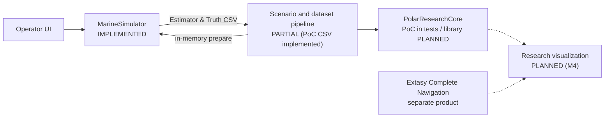

# System context

Status: **documentation of the repository as of 2026-11-16.** Planned boxes are not code in this repository.

This diagram places MarineSimulator among the systems a controlled polar-estimation study would use. A box is **implemented** only when this repository contains the behavior. **Partially implemented** means a real type or path exists and a stated part of the responsibility does not. **Planned** means the responsibility is a target and this repository does not contain it.

Read the solid arrows as data that exists today (including PoC CSV export and test-suite estimator checks). Read the dotted arrows as intended UI/library exchanges not yet built into an interactive studio. Extasy Complete Navigation is a separate application. Its internal architecture was not available in this workspace and is **unverified**.

## Responsibilities and exchanges

| System | Status | Responsibility | Data it should exchange |
|---|---|---|---|
| MarineSimulator | Implemented | Generate a coherent NMEA 0183 session from a physical state, instrument readings, and sentence rules. | Sentences on UDP or TCP, plus isolated Diagnostics CSV export. |
| Operator UI | Implemented | Setpoints, sensor switches, vessel selection, endpoints, and a separate Experiment Diagnostics window. | The operator pages write `SimulatorSettings` and the live `NMEASimulator`. Diagnostics owns an isolated runtime, persists its own form inputs (`experiment_diagnostics.inputs`), and hides the hidden polar from NMEA/estimator CSV. Opening the window does not start an experiment. |
| Scenario and dataset pipeline | Partial (PoC CSV implemented) | Describe one controlled run, apply it in memory, and export separated CSVs. | `ExperimentScenario` carries seed, reference polar, hidden polar, `PerformanceParameters`, sinusoidal `ExperimentWindProgram`, `ExperimentCurrentProgram` (active in `simulatedCurrent`), `courseSweepDegreesPerSecond`, duration, sample interval, and `ExperimentOutputContract`. `ExperimentDatasetExporter` writes `experiment-measurements.csv` and `experiment-truth.csv`; saved JSON scenario files remain M4. |
| PolarResearchCore | PoC in tests / library planned | Estimate a polar from measurements the chart plotter could have seen, and score it against a hidden polar or geometry prior. | Receives the reference polar (or `ParametricPolarGenerator` prior) and permitted estimator CSV. Validated in `PolarRecoveryProofOfConceptTests` and `ParametricPolarComparisonTests`; standalone module/M4 integration planned. |
| Research visualization | Planned | Show estimated polars, residuals, and experiment runs. | Should read research outputs, not the simulator's live UI state. Not present in this repository. |
| Extasy Complete Navigation | Separate product | Chart plotter under study. This simulator can be aimed at it. | NMEA 0183. Whether Extasy stores, filters, or drops sentences is **unverified** here. |

## Boundaries

Four boundaries are already enforced in code.

1. **Physical truth against the wire.** `EnvironmentTruth` and `VesselTruth` are not fields of `SimulationSnapshot` and are not NMEA sentences. See `Model/SimulationState.swift` and `Model/SimulationSnapshot.swift`.
2. **Hidden polar against the reference polar.** Speed uses `hiddenPolarOverride` when it is set, otherwise the selected profile. `VesselObservation.referenceProfile` is the profile an estimator may be told. The snapshot has no polar identity. See `NMEA/SimulationEngine.swift` (`hiddenTargetSpeedKnots`) and `Model/ExperimentScenarioRunner.swift`.
3. **Sensor availability against motion.** A disabled instrument clears its published value and its sentences. Wind, heading, depth, and speed samples are still stored, and the boat still moves. See `NMEA/SimulationEngine.swift`.
4. **Measurement error against motion.** A prepared experiment records one sample after the tick and publishes it on the snapshot. The sample is not written back into vessel or environment truth. A normal session has no sample. See `.agent/guides/m3.4-sensor-measurements.md`.

The operator's 1 Hz center-and-offset redraw is not on the measurement side of boundary 4. That redraw is committed into physical truth. Treating it as sensor noise would be a false description of the code.

## What this repository is not

MarineSimulator is a general NMEA 0183 simulator. Research behavior is opt-in through `ExperimentScenarioRunner.prepare`. A normal session has a nil hidden-polar override and a nil experiment generator, and it keeps system randomness.

NMEA 2000, CFD, 6-DOF dynamics, and sail-by-sail aerodynamics are parked in `.agent/ROADMAP.md`. They are not architectural layers waiting behind a flag.
