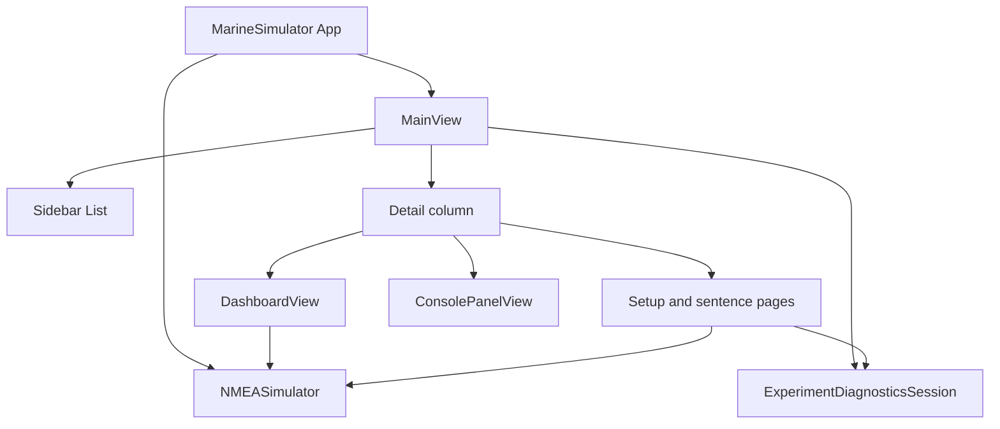

# UI architecture

Status: **audit of the macOS window as of 2026-11-11.** The minimum system is macOS 26. This page describes the interface. It does not replace the physics map in `marinesimulator-components.md` or the data path in `experiment-data-flow.md`.

The application is one SwiftUI window. `MarineSimulator` in `App/MarineSimulator.swift` owns `NMEASimulator` and passes it to `MainView`. The window minimum is 960 by 640 points. The default size is 1180 by 760. Resizing stops at the minimum (`windowResizability(.contentMinSize)`).

`ExperimentDiagnosticsSession` is created in `MainView` and is not written into `NMEASimulator`. Opening Diagnostics does not prepare a run.

## Layers

| Layer | Types | Responsibility |
|---|---|---|
| Scene | `MarineSimulator`, `MarineSimulatorCommands` | One window, menu commands, minimum size. |
| Shell | `MainView`, `SidebarNavigation`, `MainWindowToolbar` | Sidebar selection, toolbar Start/Stop, which page is visible. |
| Operator model | `NMEASimulator` | Setpoints, switches, transport, snapshots, console text. |
| Experiment model | `ExperimentDiagnosticsSession` | Isolated prepare, step, pause, and readout. |
| Page chrome | `PageContainer`, `SentencePage`, `PageChrome` | Insets and scrolling for setup and sentence pages. |
| Dashboard chrome | `AppChrome`, `DashboardView`, rails | Map, live controls, inspector, console in a column. |
| Instrument drawing | `BoatMapView`, `AnemometerView`, `CompassView`, `ConsoleLogRepresentable` | AppKit where SwiftUI is the wrong tool. |

## What each major page does

| Page | File | Where it sits | Implementation | State | Layout |
|---|---|---|---|---|---|
| Dashboard | `Views/Dashboard/DashboardView.swift` | Sidebar, Dashboard | SwiftUI plus MapKit and an AppKit marker | `NMEASimulator`, dock flags in `UserDefaults` | Map full bleed. Docks and console share a column above the map. |
| Connection | `Views/ConnectionView.swift` | Setup | SwiftUI | `NMEASimulator.outputEndpoints` | `PageContainer` and `SettingsCard`. |
| Simulation | `Views/SimulationView.swift` | Setup | SwiftUI `Form` | `NMEASimulator`, one `@AppStorage` disclosure | `PageContainer`. |
| Boat Profile | `Views/BoatProfileEditor.swift` (`BoatSetupDetailView`) | Setup | SwiftUI `HSplitView` | `NMEASimulator` plus `VesselLibrarySession` | Fixed library column, flexible detail. No page container. |
| Diagnostics | `Views/ExperimentDiagnosticsView.swift` | Setup | SwiftUI `GroupBox` list | `ExperimentDiagnosticsSession` only | `PageContainer` at 880 points wide. |
| Manual | `Views/HelpViews/ManualView.swift` | Setup | SwiftUI `HStack` | Local search and topic selection | Fixed 320-point topics column, divider, flexible article. Avoids `HSplitView` min-size constraint churn during console resizing. |
| Wind, Compass, Hydro, GPS | `WindConfig`, `HeadingConfig`, `HydroConfig`, `GPSConfig` | Sentences | SwiftUI `SentencePage` | `NMEASimulator` plus local help popovers | Two columns above 720 points, one column below. Bottom padding clears the console. |
| Toolbar | `MainWindowToolbar` in `MainView.swift` | Window toolbar | SwiftUI | `NMEASimulator.isTransmitting` | Start/Stop at `.primaryAction`. Status at `.status`. |

Sentence help popovers live under `Views/HelpViews/`. They are not sidebar destinations.

## Shared pieces

`PageContainer` and `pageContentFrame` (`Views/ConfigurationChrome.swift`) scroll a column up to `PageChrome.maxWidth` (920) with 24 points of padding. Connection, Simulation, and Diagnostics use it. Diagnostics overrides the width to 880.

`SentencePage` (`Views/SentencePanelLayout.swift`) is the shared sentence layout. `SentenceCard` and `SentencePreviewCard` are `GroupBox` containers. `ViewKit` supplies the sentence toggle row, the interval stepper, and the large live number.

`SettingsCard` and `EndpointEditorView` are used by Connection. `AppChrome` is used by the dashboard rails only.

`LeadingSidePanel` (`Views/Dashboard/LeadingSidePanel.swift`) and `OpenSeaMapView` have no call site. The live dashboard uses `LeftControlsPanel` and `BoatMapView` instead.

## Console ownership

One console is in the tree at a time. Height stays the single `ConsoleHeightStorage` value.

On the dashboard, `DashboardView` keeps the console in the column under the docks. The map remains full-bleed behind that column. `SidebarItem.dashboard.placesConsoleInTheShell` is false, so `MainView` does not add a second console. The same dashboard identity and map host stay mounted across navigation, but `retainedDashboardSize(fitting:)` proposes zero size on every non-dashboard page. The hidden map therefore does not join the detail page's full-size layout.

On every other page, `MainView` uses a `VStack`: the page takes the flexible height, and `ConsolePanelView` takes its own height below it. Dragging the handle changes that height immediately, because the panel’s displayed height is its layout height. The console toolbar's show/hide button also publishes one immediate height and cancels any active drag. Manual uses an `HStack`, not an `HSplitView`: rapid console resizing otherwise drove repeated split-child min-size updates and an AppKit constraints loop. Pages do not add clearance of their own. `SentencePage` no longer reads the console height.

A shell scroll view carries `tracksConsoleEdge()` inside its content. The anchor binds once to that enclosing clip view and freezes the `SidebarItem` and slot it was created with. A later change to the sidebar selection does not retarget it. The detail page also uses `.id(selected)`, so the next destination gets a new anchor. A callback after that retarget is ignored. The drag flag lives on `ConsoleDragTracking` in `MainView`. `ConsolePanelView` sets it from the resize handle. It is not a second stored height. The clip view stays because a `ScrollPosition` write did not move it. The dashboard map does not use the anchor.

While the handle is down, the anchor keeps a gesture baseline: the offset, viewport, and whether the document end was against the console. Each callback writes `baseline + (start viewport − current viewport)`, clamped to the document that exists now. A page that started at the bottom stays on the bottom as the viewport changes. Returning the console to its starting height returns that same document point. An event-local `didLiveScrollNotification` replaces the baseline for real user input during the drag; programmatic echoes are excluded. A window resize with the handle up does not move the offset. Native scroll indicators remain enabled, and their movement or resizing while the viewport changes is accepted system behavior.

The same anchor restores the clip view when the page is created again. `MainView` owns one `PagePresentationSession` for the window. The key is the frozen `SidebarItem` plus a slot string (`primary`, `sentences`, `preview`, `stacked`, `library`, `form`, `topics`, `body`). The first layout that has a real document, a real viewport, and that identity writes the stored document offset, clamped to the range that exists then. A sample that arrives before the identity is known does not write. A missing entry leaves the scroller at its initial origin. Later user scrolling and console drags replace the stored offset for that region only. A clamp on a shorter document during restore does not erase the stored point, so a later taller document can return to it. Restoration does not set the drag flag. Pages are still created by the `switch` and destroyed on leaving. The session is not written to `UserDefaults`.

An individual scroll region may update only its own presentation state, regardless of the currently selected navigation destination.

## State ownership

| State | Owner | Who may write it |
|---|---|---|
| Operator setpoints, switches, transport | `NMEASimulator` | Dashboard, setup pages, sentence pages, toolbar |
| Sidebar selection | `UserDefaults` key `main_view.selection`, mirrored by `SidebarNavigation` | Sidebar and pages that call `select` |
| Console height and mode | `UserDefaults` | `ConsolePanelView`, and the dashboard’s own binding to the same key |
| Experiment runtime | `ExperimentDiagnosticsSession` on `MainView` | Diagnostics page only |
| Vessel editor draft | `VesselLibrarySession` inside `BoatSetupDetailView` | Boat page |
| Help popovers | `@State` on the page | That page, and they are not restored |
| Page scroll offsets, Manual search, Manual topic | `PagePresentationSession` on `MainView` | The page’s clip-view anchor, and Manual |

There is no second operator model. Diagnostics does not read `NMEASimulator` for its samples. A body refresh of the diagnostics page builds sentences from the stored snapshot. It does not call `tickSimulation`.

`DiagnosticValueField` writes a number only on Return. A click on Prepare or Reset before Return keeps the previous number. That is a second source of truth for the duration of the edit: the field string and `SensorErrorConfiguration`.

## AppKit that stays

These are not compatibility shims for older systems. Each one does something SwiftUI did not do reliably here.

| Piece | Why it stays |
|---|---|
| Console clip-view anchor | A `ScrollPosition` write did not move the page the operator was reading. The same write restores the page after navigation. |
| Console `NSTextView` | A SwiftUI list of log rows stalled a long run. |
| Console resize handle | A SwiftUI drag used the moving bar’s coordinates and fought the split. |
| Dashboard and GPS maps | MapKit’s `MKMapView`, including the boat marker image. |
| Sidebar flattener | Hides the split view’s vibrancy so the list can stay black. |
| Outside-click resign | A value field commits when the click leaves it. |

`OpenSeaMapView` has no call site. `NavigationSplitView` is already the shell. `@Observable` is already the model. Scroll restoration uses the clip view, not `ScrollPosition`, so there is one offset for both the console drag and the return visit. A later pass can try `ScrollPosition` again only after a drag on a built window matches the clip view. Do not add a decorative Liquid Glass layer. The sidebar’s forced black is a local override of the system material, not a macOS 26 requirement.

## Presentation that still resets

These are not operator setpoints, vessel records, or experiment samples.

- The dashboard map stays mounted, so its camera stays. The docks are rebuilt on return, so their scroll offset and the plain `DisclosureGroup`s in Live Controls start closed again. The live-control category is already in `UserDefaults`.
- GPS creates a new `MKMapView` on each visit and sets a fresh region. Keeping that camera is a separate change. Do not mount a second map to hold it.
- Boat Profile rebuilds `VesselLibrarySession`, including the highlighted row and any unsaved name, model, or year buffer. The active vessel stays on `NMEASimulator`. Lifting the editor session needs its own design so a half-typed name is not saved by navigation.
- Sentence help popovers and the diagnostics number field reset. The field commits only on Return, so the uncommitted string must not become the experiment setting.
- Simulation’s advanced disclosure and the GPS section groups already use `UserDefaults`. The console height and mode are one shared value, not one value per page.
- The wide sentence columns and the narrow stacked column keep separate slots. Crossing the 720-point breakpoint uses the slot for the layout that is on screen.

## Inconsistencies that are structural

- The dashboard console sits over the map. Every other page reserves the console’s height in the shell column.
- Numeric readouts use three formatters: `ViewKit.displayLabel` (`String(format:)` and `"--"`), inspector helpers `deg` and `kn` in `SideToolbarRight.swift`, and `NMEANumericFormatting` plus the word Unavailable on Diagnostics.
- Sentence toggles force `.switch`. Diagnostics toggles use the macOS default, which is a checkbox.
- The sidebar list background is forced black. The detail pages use the system background. The dashboard rails use material.

## What not to merge

Do not fold `ExperimentDiagnosticsSession` into `NMEASimulator`. Do not put the hidden polar on a readout. Do not replace `NavigationSplitView` with a second navigation stack. Charts, scenario files, and a research studio are not part of this shell.
