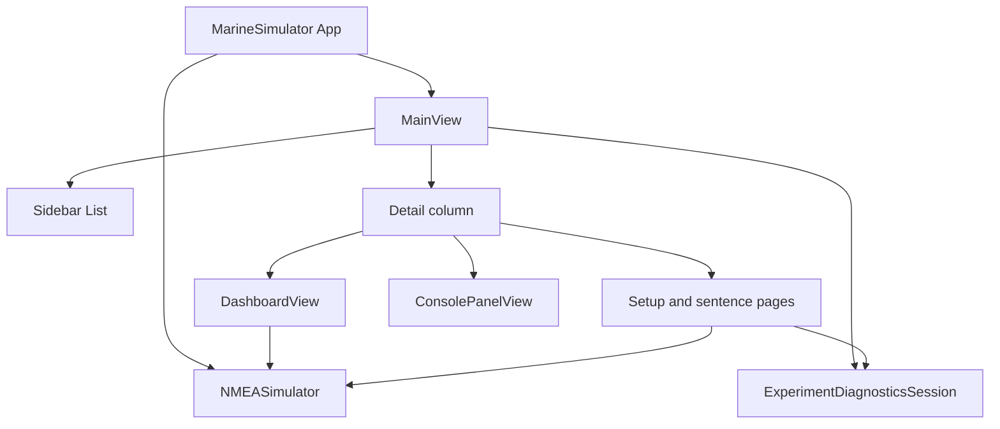

# UI architecture

Status: **current shell architecture as of 2026-11-13.** The minimum system is macOS 26. This page describes the interface. It does not replace the physics map in `marinesimulator-components.md` or the data path in `experiment-data-flow.md`.

The application is one SwiftUI window. `MarineSimulator` in `App/MarineSimulator.swift` owns `NMEASimulator` and passes it to `MainView`. The window minimum is 960 by 640 points. The default size is 1180 by 760. Resizing stops at the minimum (`windowResizability(.contentMinSize)`).

`ExperimentDiagnosticsSession` is created in `MainView` and is not written into `NMEASimulator`. Opening Diagnostics does not prepare a run.

## Layers

| Layer | Types | Responsibility |
|---|---|---|
| Scene | `MarineSimulator`, `MarineSimulatorCommands` | One window, menu commands, minimum size. |
| Shell | `MainView`, `SidebarNavigation`, `MainWindowToolbar` | Sidebar selection, toolbar Start/Stop, which page is visible. |
| Operator model | `NMEASimulator` | Setpoints, switches, transport, snapshots, console text. |
| Experiment model | `ExperimentDiagnosticsSession` | Isolated prepare, step, pause, and readout. |
| Page chrome | `PageContainer`, `SentencePage`, `PageChrome` | Insets and scrolling for setup and sentence pages. |
| Dashboard chrome | `AppChrome`, `DashboardView`, rails | Map, live controls, inspector, console in a column. |
| Instrument drawing | `BoatMapView`, `AnemometerView`, `CompassView`, `ConsoleLogRepresentable` | AppKit where SwiftUI is the wrong tool. |

## What each major page does

| Page | File | Where it sits | Implementation | State | Layout |
|---|---|---|---|---|---|
| Dashboard | `Views/Dashboard/DashboardView.swift` | Sidebar, Dashboard | SwiftUI plus MapKit and an AppKit marker | `NMEASimulator`, dock flags in `UserDefaults` | Map full bleed. Docks and console share a column above the map. |
| Connection | `Views/ConnectionView.swift` | Setup | SwiftUI | `NMEASimulator.outputEndpoints` | Adaptive card grid in `PageContainer`. Health and warning are full width. |
| Simulation | `Views/SimulationView.swift` | Setup | SwiftUI cards | `NMEASimulator`, one `@AppStorage` disclosure | Adaptive card grid in `PageContainer`. Dependent sections stay together. |
| Boat Profile | `Views/BoatProfileEditor.swift` (`BoatSetupDetailView`) | Setup | SwiftUI fixed 320-point `HStack` and native `List` in a lazy retained host | `NMEASimulator` plus one retained `VesselLibrarySession` | Fixed library column, divider, flexible detail form. No page container. Avoids `HSplitView` min-size constraint churn during console resizing. |
| Diagnostics | `Views/ExperimentDiagnosticsView.swift` | Setup | SwiftUI `GroupBox` list | `ExperimentDiagnosticsSession` only | `PageContainer` at 880 points wide. |
| Manual | `Views/HelpViews/ManualView.swift` | Setup | Ephemeral SwiftUI `HStack` with native `List` | Search and topic selection in `PagePresentationSession` | Fixed 320-point topics column, divider, flexible article. Avoids `HSplitView` min-size constraint churn during console resizing. |
| Wind, Compass, Hydro, GPS | `WindConfig`, `HeadingConfig`, `HydroConfig`, `GPSConfig` | Sentences | Ephemeral SwiftUI `SentencePage` | `NMEASimulator` plus local help popovers | Two columns above 720 points, one column below. GPS currently recreates its map and camera. |
| Toolbar | `MainWindowToolbar` in `MainView.swift` | Window toolbar | SwiftUI | `NMEASimulator.isTransmitting` | Start/Stop at `.primaryAction`. Status at `.status`. |

Sentence help popovers live under `Views/HelpViews/`. They are not sidebar destinations.

## Shared pieces

`PageContainer` and `pageContentFrame` (`Views/ConfigurationChrome.swift`) scroll a column with 24 points of padding and the window background. Diagnostics, Manual's article, and the sentence pages keep `PageChrome.maxWidth` (920); Diagnostics still overrides that to 880. Connection and Simulation use `ResponsiveLayout.adaptivePageMaxWidth` (1120) so two configuration cards can sit side by side.

Semantic colors, type roles, spacing, and breakpoints live on `DesignToken`. `PageChrome`, `ResponsiveLayout`, `BoatProfileLayout`, and `ShellChrome` are the layout names for those values. `AppColors` still holds the console palette and the tinted status colors of pages that are not migrated. The rules are in `ui-design-system.md`.

## Responsive layout

`ResponsiveLayout.widthClass(for:)` classifies the width proposed to the page body after the page inset. It does not measure height. The window minimum stays 960×640, and that minimum does not guarantee a 720-point-wide or 600-point-tall content area. The sidebar, toolbar, and console reduce what the page receives. Pages scroll.

| Class | Available content width | What it does |
|---|---|---|
| Compact | below 720 | One configuration column. Boat and sail rows stack when their own row is narrower than the compact grid. |
| Regular | 720 up to, but not including, 900 | Still one configuration column. |
| Wide | 900 and above | Two configuration columns. Each card is 440–520 points with a 20-point gutter. Cards do not stretch past 520. |

900 is `440 + 20 + 440`. There is no separate fallback size.

The retained page host keeps the real SwiftUI view type. Erasing that root as `AnyView` kept the first render and then dropped later invalidation until a size change. Additional Outputs reads `outputEndpoints` in its own view, so an added or removed endpoint appears without navigation. A renamed primary endpoint field updates on its own. `TimerStatusText` is a direct child of the Transmission `SettingsCard` and reads the timer mode in its own body. `SendIntervalText` reads the interval the same way. Both refresh while the page stays mounted. The window toolbar reads the same simulator. That subscription suppresses later invalidation inside the root hosting view, so the dashboard stays in its own host. `ControlSliderView` reads the simulator value in its own body, so wind, environment, hydro, heading, and boat controls refresh while that host is mounted. True wind uses that same control, including its variation stepper. The Boat heading field is the command. With a gyro, that command is stored as the magnetic sample the tick steers from, and the large number is the gyro measurement published by the tick. Without a gyro, the field is magnetic heading and the large number is the live compass. The Heading segment reads those measurements and does not steer. Connection and Simulation choose one stack from the available content width. `SetupColumns` builds a `VStack` below 900 points, or an `HStack(alignment: .top)` of a leading `VStack` and a trailing `VStack` at 900 and above, with full-width sections before or after that pair. Card views may be created again when that width class changes. Bindings stay on the observable model, and the retained `NSHostingView` root stays across navigation. This is not a `SplitView` or `HSplitView`. Keyboard and focus order on these pages stay a manual runtime check.

Connection order is health, the all-outputs warning, Primary Output, Transmission, and Additional Outputs. Wide columns put Primary Output and Transmission on the leading side and Additional Outputs on the trailing side. Health and the warning stay full width. The warning is omitted while any output is enabled. Simulation order is Hardware Profile, Sentence Update Rates, Test Presets, Weather Source, Onboard Sensors, and Advanced controls. Wide columns keep the first pair leading and the next pair trailing. Sensors and advanced controls stay full width in both the one-column and two-column stacks. Reading order does not change with width. Onboard sensor groups are an ordinary vertical stack.

`SettingsCard` titles are headings. The card is an accessibility group that still exposes its child controls. Help and status text stay readable inside that group. Boat section titles use the same heading role.

Boat detail is `VesselLibraryDetail`. Its body reads `highlightedID`, the edit buffer, and the vessel list, and the form's stable identity is the vessel id. A library selection refreshes those values in that child. The retained host and `VesselLibrarySession` stay. Deleting a vessel or navigating is not an invalidation path. Boat and sail rows use `CompactFormRow` through `FormTextRow` and `FormMenuRow`. Every sail identity, measurement, reef-count, note, source, and active-sail field has one persistent label and one labeled editor. The row reads its current buffer in the one branch that fits: at a row width of at least 446 points an `HStack` with a trailing 152-point label column, a 14-point gap, and a leading value column of 280–360 points; a narrower row is a `VStack` with the label above the value. The card stays full width. The 320-point library column is unchanged. Units stay next to the value.

The detail column's toolbar title is `SidebarItem.pageTitle`. Sidebar labels use those same strings. Pages do not repeat that title. `ShellContentTopSeparator` is the one separator under the toolbar; pages do not add another. Dashboard compact panels and the Dashboard top strip are not part of this slice. Dashboard, Manual, Diagnostics, and the sentence pages are not on the semantic tokens yet.

`SentencePage` (`Views/SentencePanelLayout.swift`) is the shared sentence layout. `SentenceCard` and `SentencePreviewCard` are `GroupBox` containers. `ViewKit` supplies the sentence toggle row, the interval stepper, and the large live number.

`SettingsCard` and `EndpointEditorView` are used by Connection. `AppChrome` is used by the dashboard rails only.

`LeadingSidePanel` (`Views/Dashboard/LeadingSidePanel.swift`) and `OpenSeaMapView` have no call site. The live dashboard uses `LeftControlsPanel` and `BoatMapView` instead.

## Destination lifecycle classes

| Class | Destinations | Current behavior |
|---|---|---|
| `retainedDashboardMap` | Dashboard | Existing specialized map host stays mounted; detail pages propose it zero size. |
| `retainedForm` | Connection, Simulation | One stable page root persists after first visit. |
| `retainedSessionView` | Boat Profile | One stable page root and `VesselLibrarySession` persist after first visit. |
| `retainedMapResource` | GPS | Metadata only. No retained GPS map exists yet; camera resets when the page is recreated. |
| `ephemeral` | Manual, Diagnostics, Wind, Hydro, Compass | The destination tree is released on leave. |

## Console ownership

One console is in the tree at a time. Height stays the single `ConsoleHeightStorage` value.

On the dashboard, `DashboardView` keeps the console in the column under the docks. The map remains full-bleed behind that column. `SidebarItem.dashboard.placesConsoleInTheShell` is false, so `MainView` does not add a second console. The same dashboard identity and map host stay mounted across navigation, but `retainedDashboardSize(fitting:)` proposes zero size on every non-dashboard page. The hidden map therefore does not join the detail page's full-size layout.

On every other page, `MainView` uses a `VStack`: the page takes the flexible height, and `ConsolePanelView` takes its own height below it. Dragging the handle changes that height immediately, because the panel’s displayed height is its layout height. The console toolbar's show/hide button also publishes one immediate height and cancels any active drag. Manual and Boat Profile use a fixed-column `HStack`, not an `HSplitView`: rapid console resizing otherwise drove repeated split-child min-size updates and an AppKit constraints loop. Boat Profile keeps a 320-point library column and a trailing form. Pages do not add clearance of their own. `SentencePage` no longer reads the console height.

A shell scroll view carries `tracksConsoleEdge()` inside its content. The anchor binds once to that enclosing clip view and freezes the `SidebarItem` and slot it was created with. Connection, Simulation, and Boat Profile stay mounted after their first visit in stable AppKit hosts, but only the active host participates in the console edge; the host parks and suspends its anchor after saving the current offset, then resumes the same scroll view without propagating selection into the heavy SwiftUI tree. Other detail pages use `.id(selected)`, so the next destination gets a new anchor. A callback after retirement is ignored. The drag flag lives on `ConsoleDragTracking` in `MainView`. `ConsolePanelView` sets it from the resize handle. It is not a second stored height. The clip view stays because a `ScrollPosition` write did not move it. The dashboard map does not use the anchor.

While the handle is down, the anchor keeps a gesture baseline: the offset, viewport, and whether the document end was against the console. Each callback writes `baseline + (start viewport − current viewport)`, clamped to the document that exists now. A page that started at the bottom stays on the bottom as the viewport changes. Returning the console to its starting height returns that same document point. An event-local `didLiveScrollNotification` replaces the baseline for real user input during the drag; programmatic echoes are excluded. A window resize with the handle up does not move the offset. Native scroll indicators remain enabled, and their movement or resizing while the viewport changes is accepted system behavior.

The same anchor restores the clip view when a page is created or resumed. `MainView` owns one `PagePresentationSession` for the window. The key is the frozen `SidebarItem` plus a slot string (`primary`, `sentences`, `preview`, `stacked`, `library`, `form`, `topics`, `body`). The first layout that has a real document, a real viewport, and that identity writes the stored document offset, clamped to the range that exists then. A sample that arrives before the identity is known does not write. A missing entry leaves the scroller at its initial origin. Later user scrolling and console drags replace the stored offset for that region only. A clamp on a shorter document during restore does not erase the stored point, so a later taller document can return to it. Restoration does not set the drag flag.

Connection and Simulation are lazy `retainedForm` destinations. Boat Profile is lazy `retainedSessionView`. `RetainedDestinationHost` owns one unchanged `NSHostingView` root per retained page. Boat Profile therefore keeps one `VesselLibrarySession` after its first visit, so selection survives navigation. Valid identity, hull, rig, and sail edits autosave through the vessel library; invalid intermediate text does not replace the last persisted profile. Selection changes update the host boundary and do not re-enter the retained page bodies. Normal-size changes use AppKit layout; production does not call `layoutSubtreeIfNeeded` synchronously. An inactive host has `isHidden = true`, zero size and alpha, disabled hit testing and accessibility, resigned responder state with observation, and a suspended console-edge anchor. Reactivation reverses those gates and resumes the same anchor. There is no recursive per-field mutation. The shell still owns one console.

This small AppKit boundary exists because the measured SwiftUI layout wrapper still rebuilt form bodies. A DEBUG experiment that omitted `isHidden` did not reduce default key-view work and worsened hitch rate, so it was removed. Automatic `NSWindow` key-view recalculation remains enabled; the app does not manually own the whole key loop because keyboard navigation and VoiceOver correctness take precedence.

Manual, Diagnostics, Wind, Hydro, Compass, and GPS remain ephemeral. Manual keeps its accepted 320-point `HStack`, native `List`, and original console-edge anchors. Retaining its scrolled topics list reproducibly traps in SwiftUI `DynamicContainerInfo.tryRemovingItem` with `DynamicPreferenceCombiner`; keep it ephemeral until a separately reviewed design avoids parking that preference/list container. Do not inject an AppKit anchor. GPS is classified as metadata-only `retainedMapResource`, but no retained GPS map is installed yet.

An individual scroll region may update only its own presentation state, regardless of the currently selected navigation destination.

## State ownership

| State | Owner | Who may write it |
|---|---|---|
| Operator setpoints, switches, transport | `NMEASimulator` | Dashboard, setup pages, sentence pages, toolbar |
| Sidebar selection | `UserDefaults` key `main_view.selection`, mirrored by `SidebarNavigation` | Sidebar and pages that call `select` |
| Console height and mode | `UserDefaults` | `ConsolePanelView`, and the dashboard’s own binding to the same key |
| Experiment runtime | `ExperimentDiagnosticsSession` on `MainView` | Diagnostics page only |
| Vessel editor draft and selection | One retained `VesselLibrarySession` inside `BoatSetupDetailView` | Boat page |
| Help popovers | `@State` on the page | That page, and they are not restored |
| Page scroll offsets, Manual search, Manual topic | `PagePresentationSession` on `MainView` | The page’s clip-view anchor, and Manual |

There is no second operator model. Diagnostics does not read `NMEASimulator` for its samples. A body refresh of the diagnostics page builds sentences from the stored snapshot. It does not call `tickSimulation`.

`DiagnosticValueField` writes a number only on Return. A click on Prepare or Reset before Return keeps the previous number. That is a second source of truth for the duration of the edit: the field string and `SensorErrorConfiguration`.

## AppKit that stays

These are not compatibility shims for older systems. Each one does something SwiftUI did not do reliably here.

| Piece | Why it stays |
|---|---|
| Console clip-view anchor | A `ScrollPosition` write did not move the page the operator was reading. The same write restores the page after navigation. |
| Console `NSTextView` | A SwiftUI list of log rows stalled a long run. |
| Console resize handle | A SwiftUI drag used the moving bar’s coordinates and fought the split. |
| Dashboard and GPS maps | MapKit’s `MKMapView`, including the boat marker image. |
| Sidebar flattener | Hides the split view’s vibrancy so the list can stay black. |
| Outside-click resign | A value field commits when the click leaves it. |
| Boat Profile delete sheet | Library Delete is an AppKit button because SwiftUI buttons in the retained host are not hit targets. `.confirmationDialog` set from that action stayed pending until the host laid out again, and navigation is that layout, so the prompt appeared after leaving the page. `NSAlert.beginSheetModal` presents on the click. A click with no window stores nothing. |

`OpenSeaMapView` has no call site. `NavigationSplitView` is already the shell. `@Observable` is already the model. Scroll restoration uses the clip view, not `ScrollPosition`, so there is one offset for both the console drag and the return visit. A later pass can try `ScrollPosition` again only after a drag on a built window matches the clip view. Do not add a decorative Liquid Glass layer. The sidebar’s forced black is a local override of the system material, not a macOS 26 requirement.

## Presentation lifecycle

These are not operator setpoints, vessel records, or experiment samples.

- The dashboard map stays mounted, so its camera stays. The docks are rebuilt on return, so their scroll offset and the plain `DisclosureGroup`s in Live Controls start closed again. The live-control category is already in `UserDefaults`.
- Boat Profile retains one root and `VesselLibrarySession` after first visit. Highlighted selection survives navigation. Valid edits are already persisted, so navigation shows the latest saved profile. Delete confirmation is the AppKit sheet above, not a SwiftUI flag on the retained root, so leaving the page cannot reveal a prompt that the click did not already show.
- GPS still creates a new `MKMapView` on each visit and sets a fresh region. `retainedMapResource` is lifecycle metadata for a future slice, not a retained map implementation. Do not mount a second map to hold it.
- Sentence help popovers and the diagnostics number field reset. The field commits only on Return, so the uncommitted string must not become the experiment setting.
- Simulation’s advanced disclosure and the GPS section groups already use `UserDefaults`. The console height and mode are one shared value, not one value per page.
- The wide sentence columns and the narrow stacked column keep separate slots. Crossing the 720-point breakpoint uses the slot for the layout that is on screen.

## Inconsistencies that are structural

- The dashboard console sits over the map. Every other page reserves the console’s height in the shell column.
- Numeric readouts use three formatters: `ViewKit.displayLabel` (`String(format:)` and `"--"`), inspector helpers `deg` and `kn` in `SideToolbarRight.swift`, and `NMEANumericFormatting` plus the word Unavailable on Diagnostics.
- Sentence toggles force `.switch`. Diagnostics toggles use the macOS default, which is a checkbox.
- The sidebar list background is forced black. The detail pages use the system background. The dashboard rails use material.

## What not to merge

Do not fold `ExperimentDiagnosticsSession` into `NMEASimulator`. Do not put the hidden polar on a readout. Do not replace `NavigationSplitView` with a second navigation stack. Charts, scenario files, and a research studio are not part of this shell.
