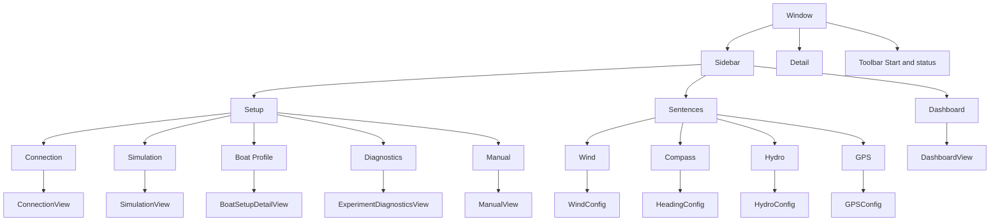
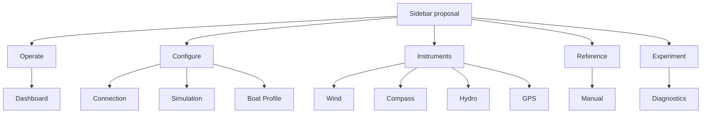

# UI navigation map

Status: **current hierarchy, plus a labeled proposal.** The proposal is not implemented.

## Current hierarchy

`MainView` is a `NavigationSplitView` with `.prominentDetail`. The sidebar is a `List` of `SidebarItem` in three sections. Selection is stored in `main_view.selection`. The detail column shows one page. The dashboard stays mounted and is hidden when another item is selected, so the map is not destroyed.

The toolbar is not a second destination. Start and Stop call `NMEASimulator`. The status button jumps to Connection. Sentence pages can set `SidebarNavigation.selectedItem` to open a setup page. That writes the same selection key.

The console is not a sidebar item. On the dashboard it is the bottom of the dock column. On every other page it is the bottom of the detail column, and the page above it scrolls in the remaining height.

Help for one sentence is a popover from `ViewKit.ToggleRowWithInfo`, not a navigation push. The Manual page is the long-form version of that material.

## Why this split view should stay

Apple’s split-view guidance says a sidebar lists top-level areas and the secondary pane shows the selection, with the selection kept highlighted. `NavigationSplitView` already does that. The hierarchy is one level in the sidebar and one page in the detail. That is within the guidance to avoid a deep sidebar.

Replacing it would move every page without making the console or the readout rows correct. The useful change is grouping, not a new navigator.

## Proposed grouping

The change is a sidebar section only. Routes, types, and the operator model stay.

Diagnostics leaves the Setup section so an experiment is not presented as another operator preference. Manual leaves Setup because it does not change the simulator. Connection, Simulation, and Boat stay together because they write `NMEASimulator`.

No new window, no inspector column, and no chart destination are part of this proposal.
