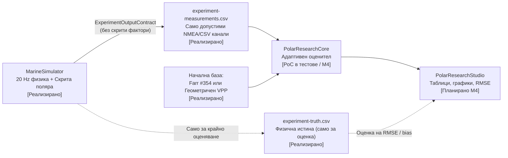

# План за обсъждане с научния ръководител

**Магистърска теза · Ревизия 0.4 · 16 ноември 2026 г. · Работен документ**

## Разработване и симулационна оценка на адаптивен алгоритъм за оценяване на полярните характеристики на ветроходна яхта от NMEA 0183 данни

> Този план предлага изцяло симулационен експериментален дизайн с реализирано и верифицирано симулационно ядро. Реалните плавания не са условие за основните резултати; те остават възможна външна проверка в Етап 5.

**Свързани системи:** `MarineSimulator` (генератор на истина, измервания и CSV) · `PolarResearchCore` / `PolarResearchStudio` (оценител и визуализация) · `ExtasyCompleteNavigation` (външен NMEA потребител)

---

## 1. Цел и научна позиция

Целта е да се разработи, сравни и оцени адаптивен алгоритъм за онлайн/офлайн оценяване на полярни характеристики на ветроходна яхта от непълни и неточни **NMEA 0183** наблюдения при контролирани и възпроизводими симулационни условия.

`MarineSimulator` генерира физично състояние на средата (`EnvironmentTruth`), движение на плавателния съд (`VesselTruth`), зашумени сензорни измервания (`ExperimentSensorModel`) и изолиран CSV/NMEA поток. За всеки експеримент симулаторът поддържа **скрита деградирана поляра** (`hiddenPolarOverride` и `PerformanceParameters`), която оценителят никога не получава на входа си. Така оценената поляра и прогнозите за **STW** се сравняват количествено с известната симулационна истина.

Тезата няма да твърди, че е валидирана действителната поляра на конкретна реална яхта на вода. Изводите ще са за точността, сходимостта, идентифицируемостта и устойчивостта на алгоритъма при формално описан модел и възпроизводими експериментални условия.

### Изследователски въпроси
- При какво покритие на `TWS`/`TWA` методът подобрява прогнозата на `STW` спрямо фиксирана референтна поляра (Farr VPP) или синтетичен геометричен модел „от нулата“?
- Как сензорният шум, систематичното отместване (`bias`), закъснението (`delay`/`dropout`), морското течение (`SOG`/`COG` ≠ `STW`/`HDT`) и преходните режими при маневри влияят върху точността и сходимостта?
- Подобрява ли предложеният оценител (2D изглаждане с тежести за увереност и калибрация) независимите тестови прогнози спрямо обикновена клетъчна корекция и непроменена референтна поляра?
- Колко бързо може да се открие промяна на скритата характеристика, без временните загуби при так или джайб да се отчитат като трайна деградация?

### Хипотези
- **H1:** При достатъчно стабилни наблюдения предложеният оценител намалява held-out грешката (RMSE/MAE) на `STW` спрямо фиксирана референтна поляра и спрямо геометричен VPP старт без заводска таблица.
- **H2:** Филтрирането на нестационарни участъци (инерционност от първи ред, маневри) и робустното оценяване ограничават грешката при шум и пропуски, а съвместната оценка с GNSS (`SOG`/`COG`) разкрива некалибриран `STW` bias.
- **H3:** Предварително зададена промяна в деградацията може да бъде открита с измеримо закъснение, без временните загуби при маневра да се отчитат като трайна промяна.

---

## 2. Архитектура и граница между симулатора и оценителя

За строго спазване на научната граница **„истина ↔ измервания“**, `MarineSimulator` и изследователската среда (`PolarResearchStudio`) се разделят като два независими модула (две изолирани macOS приложения в общ проект, споделящи само чистата математическа библиотека `PolarResearchCore` и обменящи стандартни CSV/NMEA данни). Така оценителят конструктивно не може да прочете скритите параметри на симулатора.

---

## 3. Сравнявани подходи и предварителен прототип (Proof of Concept)

| Подход | Роля в експеримента | Статус |
|---|---|---|
| **Фиксирана референтна поляра** | Базова линия без адаптация (Farr Design #354 за Beneteau First 40.7). | Реализирано |
| **Геометричен VPP приоритет (`ParametricPolarGenerator`)** | Синтетична начална поляра само от размерите на корпуса, рангоута и платната (без таблица на Farr) — за сценарий „лодка без заводска поляра“. | Реализирано (PoC) |
| **Клетъчна/секторна медианна корекция** | Прозрачен базов метод: медианно отношение `STW / V_ref` по 15° сектори на `|TWA|` със свиване към глобалната медиана. | Реализирано (PoC) |
| **Предложеният оценител (M4)** | Филтрира нестационарни наблюдения; 2D изглаждане по `(TWS, TWA)` без смесване на противоположни режими; тежести за качество/покритие и откриване на STW bias. | Планирано (М4) |

### Предварителни количествени резултати (към 16.11.2026)

1. **Възстановяване на деградирана поляра от зашумен CSV (`PolarRecoveryProofOfConceptTests`):**
   - *Условия:* 12 мин (`720 s`), скрита деградация `0.85 × 0.92 × 0.96 = 0.7507`, инерционност 5 s / 8 s, курс `0.5 °/s`, променлив вятър (`±20°`, `±3 kn`), течение `1.5 kn`, сензорен шум (`AWS ±0.4 kn`, `AWA ±1.5°`, `STW ±0.15 kn`, `HDT ±0.5°`).
   - *Резултат само от `experiment-measurements.csv`:* глобалният множител е възстановен в рамките на `±0.02` от истинския (`0.7507`), а RMSE по пълната `(TWS × TWA)` мрежа спада от **> 1.50 kn** на **< 0.15 kn** (**над 92% намаление на грешката**).
2. **Ефект на некалибриран лаг (`STW Bias`):**
   - При добавено систематично отместване `+0.60 kn` към `STW`, оцененият полярен множител се измества системно нагоре (`~0.88` при истински `0.80`), което обосновава включването на GNSS-базирана диагностика/калибрация на лага в Етап 4.
3. **Студен старт без заводска поляра (`ParametricPolarComparisonTests`):**
   - От чистата геометрия на *Extasy* (`LWL 10.61 m`, `V_hull 7.91 kn`, `SA_up 81.6 m²`, `SA_dn 189.3 m²`) синтетичната поляра стартира с **RMSE = 1.082 kn** спрямо Farr #354 (най-точно на фордевинд `0.586 kn`, най-консервативно на бейдевинд `1.512 kn`).
   - След 12-минутна адаптация от зашумени NMEA/CSV измервания грешката спада от **1.066 kn** на **0.547 kn** (в диапазона `50°–160°` достига `0.03–0.19 kn` от Farr), като граничното отклонение при `175°` мотивира преминаването към локално 2D изглаждане без глобално свиване между бейдевинд и фордевинд.

### Граници на модела
- **В обхват:** скрита и референтна поляра, геометричен VPP старт, NMEA 0183, `STW`/`TWS`/`TWA`/`SOG`/`COG`, векторно течение, модели на грешки, възпроизводими сценарии и количествено сравнение.
- **Извън обхват:** ORC rating сертификация, CFD, 6-DOF хидродинамика, NMEA 2000, аеродинамика по отделни платна и твърдение за полева валидност на реален корпус.

---

## 4. Експериментален протокол и метрики

Всеки експеримент има версия, `seed`, конфигурация на референтната и скритата поляра, скрити фактори (`PerformanceParameters`), вятър/течение/курс програма, активни сензорни грешки и отделени обучаващи и тестови сценарии.

| Серия | Условие | Проверяван въпрос |
|---|---|---|
| **A** | Идеални данни + многофакторна деградация | Възстановява ли се зададената скрита промяна? *(PoC преминат)* |
| **B** | Непълно `TWS`/`TWA` покритие и студен старт | Къде оценката е несигурна и не бива да се използва; как се държи без заводска поляра? |
| **C** | Шум, `STW bias`, `dropout`, закъснение, течение | Колко е устойчива оценката и може ли bias да се отдели чрез `SOG`/`COG`? |
| **D** | `Tack`, `gybe`, ускоряване (първи ред) | Отхвърлят ли се преходните участъци правилно? |
| **E** | Стъпкова, плавна и ъглово-зависима промяна | Какви са закъснението на откриване и сходимостта при бейдевинд vs. фордевинд деградация? |
| **F** | Независими тестови сценарии (held-out) | Подобрява ли се `STW` прогнозата извън данните за настройка? |

**Метрики:** MAE, RMSE и mean bias на `STW` спрямо `experiment-truth.csv`; грешка, покритие и брой проби по `(TWS, TWA)` клетки; процент правилно отхвърлени нестационарни наблюдения; време до сходимост и закъснение при смяна на режима.

**Правило за честна оценка:** Алгоритмичните хиперпараметри се фиксират преди пускането върху held-out тестовите сценарии; изпълняват се серии с множество `seed`-ове.

---

## 5. План за реализация и текущ статус

| Етап | Резултат | Статус |
|---|---|---|
| **1. Възпроизводим фундамент** | `Seed` за контролирана случайност; разделена `EnvironmentTruth` / `VesselTruth` / `SimulationSnapshot`. | **Завършен** |
| **2. Сценарии, динамика и измервания** | `ExperimentScenario`, скрити `PerformanceParameters` (инерционност, фактори), активно течение (`set`/`drift`), синусоидален вятър, курс sweep, `ExperimentSensorModel`. | **Завършен** |
| **3. Данни за експеримента и PoC** | `ExperimentDiagnosticsView` с персистентност, `ExperimentDatasetExporter` (`Export CSV…` по `ExperimentOutputContract` + отделен `Export Truth…`), PoC оценител и `ParametricPolarGenerator`. | **Завършен (PoC)** |
| **4. Пълни оценители и `PolarResearchStudio`** | JSON библиотека сценарии, ъглово-зависима деградация, `delay`/`dropout`, 2D `(TWS, TWA)` оценител, STW-bias калибрация, ORC интеграция за *Nimana* и интерактивна визуализация в `PolarResearchStudio`. | **Предстоящ (М4)** |
| **5. Анализ и оформяне на тезата** | Автоматизирани серии (A–F) с множество `seed`-ове, графики, таблици и обсъждане на ограниченията (и тест на реални логове при наличност). | **Планиран (М5)** |

### Въпроси за научния ръководител
1. Приемлив ли е изцяло симулационният дизайн и архитектурното разделение между `MarineSimulator` (генератор) и `PolarResearchStudio` (сляп оценител чрез `PolarResearchCore`)?
2. Представените Proof-of-Concept резултати (възстановяване при деградация с RMSE `< 0.15 kn`, студен геометричен старт, чувствителност към `STW bias`) потвърждават ли правилната посока за Етап 4?
3. Кой аспект да бъде основният научен акцент в Етап 4: **ъглово-зависимата деградация** (бейдевинд vs. фордевинд), **съвместната калибрация на STW bias чрез GNSS (`SOG`/`COG`)**, или **студеният старт от геометрия без заводска поляра**?
4. Какъв обем писмени междинни отчети и демонстрация се очакват за следващата среща?
