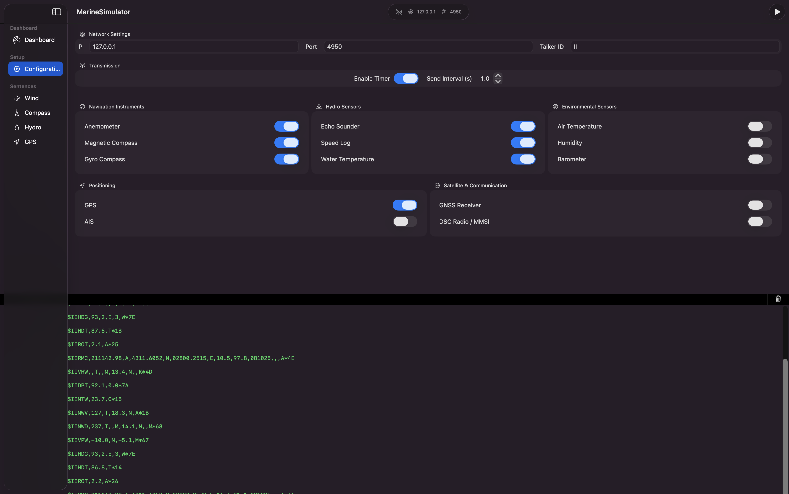

# MarineSimulator

MarineSimulator is a macOS SwiftUI app for simulating marine instrument data, transmitting NMEA 0183 output over IP, and running isolated controlled polar-research experiments.

It is built both as a practical NMEA bench tool—something you can run beside charting or instrument apps like `ExtasyCompleteNavigation`—and as a deterministic experiment generator with strict separation between physical truth, sensor measurements, and wire output.

## What It Does

- **Simulates onboard marine sensors:**
  - **Wind:** true/apparent wind speed and direction (`MWV`, `MWD`, `VPW`) plus atmospheric weather (`MDA`, `XDR`: air temperature, humidity, barometric pressure)
  - **Heading:** magnetic compass, gyro heading, variation/deviation, and rate of turn (`HDG`, `HDT`, `ROT`)
  - **Hydro:** speed through water, depth, water temperature, distance logs (`DBT`, `DPT`, `MTW`, `VHW`, `VBW`, `VLW`)
  - **GPS & Navigation:** position, SOG/COG, synthetic satellite fix/DOP, active waypoints (`RMC`, `GGA`, `VTG`, `GLL`, `GSA`, `GSV`, `ZDA`, `RMB`, `XTE`)
- **Transmits NMEA 0183 over UDP and TCP** to one or multiple concurrent endpoints, with optional **4800 / 38400 baud** bus pacing and **TCP stream fragmentation**
- **Models realistic boat & weather behavior:**
  - Beneteau First 40.7 (*Extasy*) Farr Design #354 VPP speed polar with pinching roll-off, plus vessel library (*Extasy*, *Nimana*, custom hulls/rigs/sails)
  - Live weather integration (MET Norway primary atmospheric + Open-Meteo marine sea temperature, with Ornstein–Uhlenbeck wind smoothing) or deterministic manual controls
  - Hardware profiles (`B&G Triton 2`, `Furuno FI-70`, `Garmin GMI 20`, `Yacht Devices YDNG-03`, `GPS Only`) with realistic per-sentence rates and multi-talker IDs (`GP`, `HC`, `SD`, `II`)
- **Provides a map-first Dashboard** with warm retained MapKit surface, nautical seamark overlay, persisted camera state, live control rails, and a shared bottom `NMEA` / `Transport` console drawer
- **Isolated Experiment Diagnostics (`Diagnostics`):**
  - Strictly separated `EnvironmentTruth` / `VesselTruth` vs. seeded `ExperimentSensorModel` measurements and `ExperimentOutputContract`
  - Hidden polar overrides and `PerformanceParameters` (first-order speed lag, hull/sail/trim/sea-state multipliers), sinusoidal wind swing/amplitude, continuous course sweep, and `ExperimentCurrentProgram` set/drift motion
  - Two-file CSV export (`Export CSV…` for estimator-permitted measurements only; `Export Truth…` separately for offline evaluation)

## Architecture & UI Approach

- Built **primarily in SwiftUI** on **macOS 26.0+** using native `NavigationSplitView`, shared `DesignToken` / `PageChrome` responsive layouts (`1080×640` minimum, `900 pt` split breakpoint), validation popovers, and VoiceOver labels.
- Small, localized AppKit / `NSViewRepresentable` bridges are used only where required by platform behavior (`MKMapView` / `MKZoomControl`, `NSTextView` console log + drag handle, and `RetainedDestinationHostBox` for smooth sidebar navigation).
- **20 Hz** physics tick (`SimulationEngine`), **1 Hz** environment redraw, **per-sentence** emission intervals, and **10 Hz** UI publish.

## Current Capabilities

- Coherent snapshot-based simulation tick (`SimulationSnapshot`)
- Sentence-level scheduling with Realistic vs. Custom rates, per-sentence talker IDs, and optional 4800 / 38400 baud serial pacing (with overflow backlog drops)
- Sensor toggles vs. sentence toggles and live dashboard interlocks
- Gyro-priority heading resolution and automatic tack/gybe maneuvers
- Transport diagnostics, live event history, and optional TCP stream fragmentation (staggered split writes)
- Fault injection (drop, delay, checksum corruption, invalid data/status)
- Named presets, settings JSON import/export, and persisted state across launches
- Isolated deterministic experiment runner (`ExperimentScenarioRunner`), CSV dataset exporter (`ExperimentDatasetExporter`), and geometry-based cold-start VPP prior (`ParametricPolarGenerator`)

## Screenshots

### Dashboard

### Configuration

### Sentence Setup

## NMEA 0183 Coverage

- **Wind & Atmosphere:** `MWV`, `MWD`, `VPW`, `MDA`, `XDR`
- **Heading:** `HDG`, `HDT`, `ROT`
- **GPS & Navigation:** `RMC`, `GGA`, `VTG`, `GLL`, `GSA`, `GSV`, `ZDA`, `RMB`, `XTE`
- **Hydro:** `DBT`, `DPT`, `MTW`, `VHW`, `VBW`, `VLW`

## Project Docs

- [`Docs/ProjectOverview.md`](Docs/ProjectOverview.md)
- [`Docs/CurrentTasks.md`](Docs/CurrentTasks.md)
- [`Docs/CompletedTasks.md`](Docs/CompletedTasks.md)
- [`Docs/FutureTasks.md`](Docs/FutureTasks.md)
- [`Docs/InstructionManual.md`](Docs/InstructionManual.md)
- [`Docs/ManualTestChecklist.md`](Docs/ManualTestChecklist.md)
- [`SIMULATOR_ACCURACY.md`](SIMULATOR_ACCURACY.md)
- [`.agent/ROADMAP.md`](.agent/ROADMAP.md) & [`.agent/architecture/implementation-status.md`](.agent/architecture/implementation-status.md)

## Getting Started

### Requirements

- macOS 26.0+
- Xcode

### Run

1. Clone the repository.
2. Open `MarineSimulator.xcodeproj` in Xcode.
3. Select the `MarineSimulator` scheme and `My Mac`.
4. Build and run (`⌘R`).

## Known Limitations

- UART character-level byte jitter and independent per-talker oscillator clock drift are not simulated (see [`SIMULATOR_ACCURACY.md`](SIMULATOR_ACCURACY.md))
- Sensor delay, drift, and dropout models (beyond boolean availability and bias/noise) are planned for M4
- NMEA 2000 and Signal K output protocols are not implemented yet
- `BoatProfile.nimana` ORC polar table is stored as a reference PDF and not yet parsed into `PolarTable`

## Author

Vasil Borisov

- GitHub: [bacataBorisov](https://github.com/bacataBorisov)
- Email: [vasil.borisovv@gmail.com](mailto:vasil.borisovv@gmail.com)
